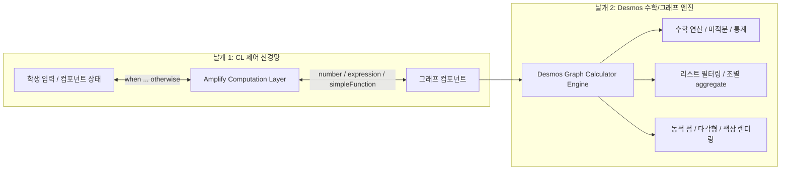

# Desmos 그래프 함수와 그래프↔CL 연결

> **소개**: Amplify Classroom 액티비티 제작 시, 화면 제어 언어인 **CL(Computation Layer)**과 함께 그래프 컴포넌트 내부에서 연산·시각화를 담당하는 **Desmos 그래핑 수식 엔진(Math & Graph Engine)**의 전체 함수 카탈로그입니다.
> **출처**: [Desmos Calculator (psh7own5ep)](https://www.desmos.com/calculator/psh7own5ep) (DesModder/Reddit u/fireflame241 정리)
> **구성**: 35개 폴더, 226개 수식, 44개 설명 주석, 7개 테이블 전체 완벽 수록

---

## 🦅 액티비티 제작의 '양대 날개' 체계

---

## 🌟 [추천 필독] 액티비티 설계자를 위한 기능별 해결사전 (Cookbook)

> **몰라서 못 썼던 숨은 Desmos 함수들**(`unique`, `sort(A, B)`, `argmax`, `polygon`, `round(x, n)`, `random(seed)` 등)을 **상황별·목적별로 즉시 찾아 쓸 수 있는 실전 쿡북**입니다. 액티비티를 기획하거나 코드를 짤 때 가장 먼저 참고해야 하는 핵심 지식 문서입니다.
>
> 👉 **액티비티 기능별 해결사전 열기 (Cookbook)**

---

## 📚 모듈별 카탈로그 목차

### 01. 기초 문법, 데이터 타입 및 조건문 (Piecewises)
- **문서 파일**: `1부`
- **포함 카테고리 수**: 6개 폴더

### 02. 수학 함수군 및 미적분 (Analysis & Calculus)
- **문서 파일**: `2부`
- **포함 카테고리 수**: 11개 폴더

### 03. 좌표, 기하 및 다각형 (Geometry & Colors)
- **문서 파일**: `3부`
- **포함 카테고리 수**: 3개 폴더

### 04. 리스트 및 데이터 가공 (Lists & Compiler Functions)
- **문서 파일**: `4부`
- **포함 카테고리 수**: 6개 폴더

### 05. 확률, 통계 및 분포 (Distributions & Regressions)
- **문서 파일**: `5부`
- **포함 카테고리 수**: 5개 폴더

### 06. 비공개 내부 함수 및 고급 테크닉 (Fragile & Internal Bindings)
- **문서 파일**: `6부`
- **포함 카테고리 수**: 4개 폴더

---

## 🔍 35개 전체 폴더 빠른 매핑 색인

| ID | 원문 폴더명 | 한국어 분류명 | 소속 문서 |
|---|---|---|---|
| `375` | Data types | **데이터 타입 (Data types)** | 1부 |
| `589` | Constants | **수학 상수 (Constants)** | 1부 |
| `402` | Piecewises | **조건 분기 (Piecewises)** | 1부 |
| `510` | Mixed fractions | **대분수 (Mixed fractions)** | 1부 |
| `480` | Percent Of | **백분율 (Percent Of)** | 1부 |
| `318` | Ans | **직전 계산값 참조 (Ans)** | 1부 |
| `2` | Trigonometry functions | **삼각함수 (Trigonometry functions)** | 2부 |
| `468` | Trig exponents | **삼각함수 거듭제곱 표기 (Trig exponents)** | 2부 |
| `458` | Trig Angle Multiplier | **각도 승수 제어 (Trig Angle Multiplier)** | 2부 |
| `20` | Hyperbolic Trigonometry functions | **쌍곡선 삼각함수 (Hyperbolic Trigonometry)** | 2부 |
| `76` | Exponential functions | **지수 및 로그 함수 (Exponential & Log functions)** | 2부 |
| `88` | Discontinuous/piecewise functions | **불연속 및 정수화 함수 (Discontinuous / Piecewise functions)** | 2부 |
| `101` | Combinatorics functions + more Number Theory functions | **조합론 및 정수론 함수 (Combinatorics & Number Theory)** | 2부 |
| `333` | Derivatives (prime notation) | **도함수 - 프라임 표기 (Derivatives: prime notation)** | 2부 |
| `344` | Derivatives (Leibniz notation) | **도함수 - 라이프니츠 표기 (Derivatives: Leibniz notation)** | 2부 |
| `616` | Integrals | **적분 (Integrals)** | 2부 |
| `516` | Sum and Product | **수열의 합과 곱 (Sum and Product: sigma, pi)** | 2부 |
| `114` | Point operations and dot access | **점 연산 및 좌표 접근 (Point operations & Dot access)** | 3부 |
| `291` | Polygon | **다각형 (Polygon)** | 3부 |
| `243` | Colors | **색상 모델 (Colors: rgb, hsv)** | 3부 |
| `485` | List indexing, ranges, slices, and filters | **리스트 인덱싱, 슬라이스 및 필터 (List indexing, ranges, filters)** | 4부 |
| `117` | List reducers (list) → number | **단일 리스트 리듀서 (List reducers: list -> number)** | 4부 |
| `137` | List double reducers (list, list) → number | **이중 리스트 리듀서 (List double reducers: list, list -> number)** | 4부 |
| `158` | List parameterized reducers (list, number) → number | **매개변수형 리듀서 (List parameterized reducers)** | 4부 |
| `254` | Compiler functions | **컴파일러 내장 함수 (Compiler functions: join, sort 등)** | 4부 |
| `439` | Functions that allow dot call | **Dot Notation 메소드 호출 (Functions that allow dot call)** | 4부 |
| `193` | Distributions | **확률 분포 (Distributions)** | 5부 |
| `200` | Functions on distributions | **분포 연산 함수 (Functions on distributions: pdf, cdf 등)** | 5부 |
| `286` | Random | **난수 생성 (Random)** | 5부 |
| `298` | Statistical display functions | **통계 시각화 함수 (Statistical display: boxplot, histogram)** | 5부 |
| `357` | Regressions | **회귀 분석 및 수치해 (Regressions)** | 5부 |
| `44` | Functions without public bindings (fragile, use at your own risk) | **비공개 내부 바인딩 함수 (Functions without public bindings - fragile)** | 6부 |
| `80` | Misc bindings for fun (fragile) | **실험용 기타 바인딩 (Misc bindings for fun)** | 6부 |
| `308` | Unsupported functions | **미지원/행렬 함수 (Unsupported functions: det, inv 등)** | 6부 |
| `dsm-metadata-folder` | DesModder Metadata | **DesModder 메타데이터** | 6부 |

---
## 💡 액티비티 제작 실전 가이드 요약
1. **값 주입 (`number`)**: CL에서 `number("x_0"): input.numericValue`로 넘기면 그래프 내부에서 $x_0$를 즉시 변수로 사용합니다.
2. **수식 주입 (`function`)**: CL에서 `function("f"): simpleFunction(input.latex)`로 주입하면 그래프에서 $f(x)$ 함수로 평가, 도함수 $f'(x)$ 자동 렌더링이 가능합니다.
3. **리스트 및 집계 (`numberList`)**: 테이블 입력이나 조별 집계 데이터를 `numberList("L"): ...`로 넘기면, `4부`의 필터와 리듀서를 통해 화면에서 실시간 집계 시각화를 완성합니다.
4. **조건부 피드백 다각형**: `3부`의 `polygon`과 `rgb` 함수를 결합해 정답/오답에 따른 다채로운 시각 효과를 연출합니다.

## 01. 기초 문법, 데이터 타입 및 조건문 (Piecewises)

> **설명**: Desmos 수식 엔진의 기본 자료형, 특수 상수, 분기 조건문(Piecewise), 대분수, 백분율, Ans 문법
> **출처**: [Desmos Graphing Calculator (psh7own5ep)](https://www.desmos.com/calculator/psh7own5ep) (Compiled by u/fireflame241)

---

#### CL(Computation Layer) 연계 핵심 포인트
* **조건문과 CL의 `when ... otherwise`**: Desmos 그래프 수식의 조건 분기 `{조건: 참값, 거짓값}`은 CL의 `when 조건 참값 otherwise 거짓값`과 1:1로 대응됩니다.
* **정의되지 않은 값(`undefined`)**: CL에서 잘못된 수식이나 빈 입력을 넣었을 때 그래프 엔진에서는 `undefined`가 되어 화면에서 렌더링이 비활성화(숨김)됩니다.
* **상수 주입**: CL에서 그래프 변수를 제어할 때 `number("c"): ...`로 값을 주입하며, Desmos는 $e, \pi, \tau$ 등을 내장 상수로 보호합니다.

---

### 상세 함수 및 수식 목록

#### 📁 데이터 타입 (Data types)
*원문 폴더명*: `Data types` (ID: `375`)

> 💡 **설명/해설 (Text ID 377)**:
> All data types:
>
> Any, ListOfAny (for functions like `length`)
> Number, ListOfNumber
> Bool, ListOfBool (used internally)
> Point, ListOfPoint
> Distribution, ListOfDistribution
> EmptyList
> ErrorType, SeedType (used internally)
> RGBColor, ListOfColor (hsv returns RGBColor)
>
> Note that `undefined` is a special number, explaining a typical cause of the issue "Cannot use a point and a number as branches in a piecewise"

> 💡 **설명/해설 (Text ID 417)**:
> The following "undefined" is actually infinity

##### 수식 1: `i_{0}=\frac{1}{0}`
- **LaTeX 원문**: $$i_{0}=\frac{1}{0}$$
- **표시 색상**: `#388c46`

##### 수식 2: `\frac{1}{i_{0}}`
- **LaTeX 원문**: $$\frac{1}{i_{0}}$$
- **표시 색상**: `#6042a6`

> 💡 **설명/해설 (Text ID 415)**:
> The following "undefined" is properly undefined

##### 수식 3: `\left[\right]\left[1\right]`
- **LaTeX 원문**: $$\left[\right]\left[1\right]$$
- **표시 색상**: `#000000` *(기본 숨김)*

---

#### 📁 수학 상수 (Constants)
*원문 폴더명*: `Constants` (ID: `589`)

##### 수식 1: `\pi`
- **LaTeX 원문**: $$\pi$$
- **표시 색상**: `#388c46`

##### 수식 2: `\tau`
- **LaTeX 원문**: $$\tau$$
- **표시 색상**: `#6042a6`

##### 수식 3: `e`
- **LaTeX 원문**: $$e$$
- **표시 색상**: `#000000`

##### 수식 4: `\infty`
- **LaTeX 원문**: $$\infty$$
- **표시 색상**: `#c74440`

> 💡 **설명/해설 (Text ID 595)**:
> Yes, +∞ and -∞ are numbers that behave like in https://en.wikipedia.org/wiki/Extended_real_number_line. (more precisely, they follow IEEE 754: https://www.geeksforgeeks.org/ieee-standard-754-floating-point-numbers/)

##### 수식 5: `\frac{1}{\infty}`
- **LaTeX 원문**: $$\frac{1}{\infty}$$
- **표시 색상**: `#388c46`

---

#### 📁 조건 분기 (Piecewises)
*원문 폴더명*: `Piecewises` (ID: `402`)

> 💡 **설명/해설 (Text ID 450)**:
> < > ≤ ≥ = are supported.
> a ≠ b is equivalent to {a=b,0}=0, though that construction can frequently be avoided by using
> {a ≠ b: c, d} ↔ {a = b: d, c}

##### 수식 1: `\left\{x<0:\ -1,\ \ x\ge0:\ 1\right\}`
- **LaTeX 원문**: $$\left\{x<0:\ -1,\ \ x\ge0:\ 1\right\}$$
- **표시 색상**: `#388c46`

##### 수식 2: `\left(x-4\right)^{2}\left\{2<x<6\right\}`
- **LaTeX 원문**: $$\left(x-4\right)^{2}\left\{2<x<6\right\}$$
- **표시 색상**: `#c74440`

> 💡 **설명/해설 (Text ID 421)**:
> If no condition is given, then that is the default clause

##### 수식 3: `\left\{x<0:\ -1,\ x-1\right\}`
- **LaTeX 원문**: $$\left\{x<0:\ -1,\ x-1\right\}$$
- **표시 색상**: `#c74440`

> 💡 **설명/해설 (Text ID 408)**:
> If no default clause is given, then fall-through inputs return undefined

##### 수식 4: `q\left(x\right)=\left\{x<0:\ x^{2}\right\}`
- **LaTeX 원문**: $$q\left(x\right)=\left\{x<0:\ x^{2}\right\}$$
- **표시 색상**: `#6042a6`

##### 수식 5: `q\left(1\right)`
- **LaTeX 원문**: $$q\left(1\right)$$
- **표시 색상**: `#2d70b3`

> 💡 **설명/해설 (Text ID 425)**:
> If no value is given, then it is 1 by default

##### 수식 6: `x^{2}\left\{x>1\right\}`
- **LaTeX 원문**: $$x^{2}\left\{x>1\right\}$$
- **표시 색상**: `#388c46`

##### 수식 7: `x^{2}\left\{x>1:1\right\}`
- **LaTeX 원문**: $$x^{2}\left\{x>1:1\right\}$$
- **표시 색상**: `#000000`

##### 수식 8: `\left\{x>1:x^{2}\right\}`
- **LaTeX 원문**: $$\left\{x>1:x^{2}\right\}$$
- **표시 색상**: `#c74440`

---

#### 📁 대분수 (Mixed fractions)
*원문 폴더명*: `Mixed fractions` (ID: `510`)

##### 수식 1: `2\frac{1}{2}-1`
- **LaTeX 원문**: $$2\frac{1}{2}-1$$
- **표시 색상**: `#6042a6`

##### 수식 2: `2+\frac{1}{2}-1`
- **LaTeX 원문**: $$2+\frac{1}{2}-1$$
- **표시 색상**: `#2d70b3`

---

#### 📁 백분율 (Percent Of)
*원문 폴더명*: `Percent Of` (ID: `480`)

##### 수식 1: `12\%\operatorname{of}25`
- **LaTeX 원문**: $$12\%\operatorname{of}25$$
- **표시 색상**: `#c74440`

##### 수식 2: `25\%\operatorname{of}12`
- **LaTeX 원문**: $$25\%\operatorname{of}12$$
- **표시 색상**: `#2d70b3`

---

#### 📁 직전 계산값 참조 (Ans)
*원문 폴더명*: `Ans` (ID: `318`)

> 💡 **설명/해설 (Text ID 453)**:
> Ans is designed for https://desmos.com/scientific and https://desmos.com/fourfunction, but it works in the calculator

> 💡 **설명/해설 (Text ID 329)**:
> Ans uses 0-based indices, so ans_1 is the value of expression 2, which is L

##### 📊 테이블 (Table ID 323): 4개 열
- 열 1: `$x_{3}$`
- 열 2: `$L$`
- 열 3: `$\operatorname{ans}_{1}$`
- 열 4: `$Col 4$`

##### 수식 1: `\operatorname{ans}_{42}`
- **LaTeX 원문**: $$\operatorname{ans}_{42}$$
- **표시 색상**: `#000000`

---

## 02. 수학 함수군 및 미적분 (Analysis & Calculus)

> **설명**: 삼각함수, 지수/로그, 불연속/정수화 함수, 조합론, 도함수(프라임 및 라이프니츠 표기), 정적분, 수열의 합/곱
> **출처**: [Desmos Graphing Calculator (psh7own5ep)](https://www.desmos.com/calculator/psh7own5ep) (Compiled by u/fireflame241)

---

#### CL(Computation Layer) 연계 핵심 포인트
* **학생 수식 파싱(`simpleFunction`)**: 학생이 입력한 수식 문자열을 CL의 `simpleFunction(input.latex)`으로 변환한 뒤, 그래프의 `function("f"): ...` 싱크로 주입하여 그래프 상에서 도함수 $f'(x)$나 정적분 $\int f(x)dx$을 동적으로 시각화할 수 있습니다.
* **`round`와 자릿수 처리**: `round(1.23456, 3)`처럼 두 번째 인수를 통해 소수점 자릿수를 그래프 엔진 내부에서 직접 제어할 수 있습니다.
* **각도 단위 유의**: Desmos 그래프는 기본적으로 라디안(radian) 단위이므로, 60분법 각도를 CL에서 주입할 때는 각도 변환에 유의해야 합니다.

---

### 상세 함수 및 수식 목록

#### 📁 삼각함수 (Trigonometry functions)
*원문 폴더명*: `Trigonometry functions` (ID: `2`)

##### 수식 1: `\sin\left(x\right)`
- **LaTeX 원문**: $$\sin\left(x\right)$$
- **표시 색상**: `#2d70b3`

##### 수식 2: `\cos\left(x\right)`
- **LaTeX 원문**: $$\cos\left(x\right)$$
- **표시 색상**: `#388c46`

##### 수식 3: `\tan\left(x\right)`
- **LaTeX 원문**: $$\tan\left(x\right)$$
- **표시 색상**: `#6042a6`

##### 수식 4: `\cot\left(x\right)`
- **LaTeX 원문**: $$\cot\left(x\right)$$
- **표시 색상**: `#000000`

##### 수식 5: `\sec\left(x\right)`
- **LaTeX 원문**: $$\sec\left(x\right)$$
- **표시 색상**: `#c74440`

##### 수식 6: `\csc\left(x\right)`
- **LaTeX 원문**: $$\csc\left(x\right)$$
- **표시 색상**: `#2d70b3`

##### 수식 7: `\arcsin\left(x\right)`
- **LaTeX 원문**: $$\arcsin\left(x\right)$$
- **표시 색상**: `#388c46`

##### 수식 8: `\arccos\left(x\right)`
- **LaTeX 원문**: $$\arccos\left(x\right)$$
- **표시 색상**: `#6042a6`

##### 수식 9: `\arctan\left(x\right)`
- **LaTeX 원문**: $$\arctan\left(x\right)$$
- **표시 색상**: `#000000`

> 💡 **설명/해설 (Text ID 15)**:
> `arctan` has a two-argument form which is often preferable. It returns values on (-π, π] rather than [-π/2, π/2]
>
> For a demonstration on why it's better, see https://www.desmos.com/calculator/beqk9rnxbl

##### 수식 10: `\arctan\left(1,-2\right)`
- **LaTeX 원문**: $$\arctan\left(1,-2\right)$$
- **표시 색상**: `#c74440`

##### 수식 11: `\operatorname{arccot}\left(x\right)`
- **LaTeX 원문**: $$\operatorname{arccot}\left(x\right)$$
- **표시 색상**: `#6042a6`

##### 수식 12: `\operatorname{arcsec}\left(x\right)`
- **LaTeX 원문**: $$\operatorname{arcsec}\left(x\right)$$
- **표시 색상**: `#000000`

##### 수식 13: `\operatorname{arccsc}\left(x\right)`
- **LaTeX 원문**: $$\operatorname{arccsc}\left(x\right)$$
- **표시 색상**: `#c74440`

---

#### 📁 삼각함수 거듭제곱 표기 (Trig exponents)
*원문 폴더명*: `Trig exponents` (ID: `468`)

##### 수식 1: `\left(\sin\left(x\right)\right)^{2}`
- **LaTeX 원문**: $$\left(\sin\left(x\right)\right)^{2}$$
- **표시 색상**: `#6042a6`

##### 수식 2: `\sin^{2}\left(x\right)`
- **LaTeX 원문**: $$\sin^{2}\left(x\right)$$
- **표시 색상**: `#2d70b3`

##### 수식 3: `\arcsin\left(x\right)`
- **LaTeX 원문**: $$\arcsin\left(x\right)$$
- **표시 색상**: `#c74440`

##### 수식 4: `\sin^{-1}\left(x\right)`
- **LaTeX 원문**: $$\sin^{-1}\left(x\right)$$
- **표시 색상**: `#000000`

---

#### 📁 각도 승수 제어 (Trig Angle Multiplier)
*원문 폴더명*: `Trig Angle Multiplier` (ID: `458`)

> 💡 **설명/해설 (Text ID 466)**:
> Try changing from radians to degrees (ew degrees)

##### 수식 1: `T_{rig}=\operatorname{trigAngleMultiplier}`
- **LaTeX 원문**: $$T_{rig}=\operatorname{trigAngleMultiplier}$$
- **표시 색상**: `#c74440`

##### 수식 2: `\frac{\tau}{4\arccos\left(0\right)}`
- **LaTeX 원문**: $$\frac{\tau}{4\arccos\left(0\right)}$$
- **표시 색상**: `#6042a6`

---

#### 📁 쌍곡선 삼각함수 (Hyperbolic Trigonometry)
*원문 폴더명*: `Hyperbolic Trigonometry functions` (ID: `20`)

##### 수식 1: `\sinh\left(x\right)`
- **LaTeX 원문**: $$\sinh\left(x\right)$$
- **표시 색상**: `#6042a6`

##### 수식 2: `\cosh\left(x\right)`
- **LaTeX 원문**: $$\cosh\left(x\right)$$
- **표시 색상**: `#000000`

##### 수식 3: `\tanh\left(x\right)`
- **LaTeX 원문**: $$\tanh\left(x\right)$$
- **표시 색상**: `#c74440`

##### 수식 4: `\coth\left(x\right)`
- **LaTeX 원문**: $$\coth\left(x\right)$$
- **표시 색상**: `#2d70b3`

##### 수식 5: `\operatorname{sech}\left(x\right)`
- **LaTeX 원문**: $$\operatorname{sech}\left(x\right)$$
- **표시 색상**: `#388c46`

##### 수식 6: `\operatorname{csch}\left(x\right)`
- **LaTeX 원문**: $$\operatorname{csch}\left(x\right)$$
- **표시 색상**: `#388c46`

> 💡 **설명/해설 (Text ID 547)**:
> British-english variants work too, such as arsinh(x)

##### 수식 7: `\operatorname{arcsinh}\left(x\right)`
- **LaTeX 원문**: $$\operatorname{arcsinh}\left(x\right)$$
- **표시 색상**: `#6042a6`

##### 수식 8: `\operatorname{arccosh}\left(x\right)`
- **LaTeX 원문**: $$\operatorname{arccosh}\left(x\right)$$
- **표시 색상**: `#000000`

##### 수식 9: `\operatorname{arctanh}\left(x\right)`
- **LaTeX 원문**: $$\operatorname{arctanh}\left(x\right)$$
- **표시 색상**: `#c74440`

##### 수식 10: `\operatorname{arccoth}\left(x\right)`
- **LaTeX 원문**: $$\operatorname{arccoth}\left(x\right)$$
- **표시 색상**: `#2d70b3`

##### 수식 11: `\operatorname{arcsech}\left(x\right)`
- **LaTeX 원문**: $$\operatorname{arcsech}\left(x\right)$$
- **표시 색상**: `#388c46`

##### 수식 12: `\operatorname{arccsch}\left(x\right)`
- **LaTeX 원문**: $$\operatorname{arccsch}\left(x\right)$$
- **표시 색상**: `#6042a6`

---

#### 📁 지수 및 로그 함수 (Exponential & Log functions)
*원문 폴더명*: `Exponential functions` (ID: `76`)

##### 수식 1: `\sqrt{x}`
- **LaTeX 원문**: $$\sqrt{x}$$
- **표시 색상**: `#c74440`

##### 수식 2: `x^{\frac{1}{5}}`
- **LaTeX 원문**: $$x^{\frac{1}{5}}$$
- **표시 색상**: `#000000`

> 💡 **설명/해설 (Text ID 587)**:
> Pro tip: use the word "surd" to sound cool

##### 수식 3: `\sqrt[5]{x}`
- **LaTeX 원문**: $$\sqrt[5]{x}$$
- **표시 색상**: `#2d70b3`

##### 수식 4: `\operatorname{log}\left(x\right)`
- **LaTeX 원문**: $$\operatorname{log}\left(x\right)$$
- **표시 색상**: `#6042a6`

##### 수식 5: `\log_{5}\left(x\right)`
- **LaTeX 원문**: $$\log_{5}\left(x\right)$$
- **표시 색상**: `#000000`

##### 수식 6: `\ln\left(x\right)`
- **LaTeX 원문**: $$\ln\left(x\right)$$
- **표시 색상**: `#000000`

##### 수식 7: `\exp\left(x\right)`
- **LaTeX 원문**: $$\exp\left(x\right)$$
- **표시 색상**: `#2d70b3`

##### 수식 8: `x^{x}`
- **LaTeX 원문**: $$x^{x}$$
- **표시 색상**: `#2d70b3`

---

#### 📁 불연속 및 정수화 함수 (Discontinuous / Piecewise functions)
*원문 폴더명*: `Discontinuous/piecewise functions` (ID: `88`)

##### 수식 1: `\operatorname{floor}\left(x\right)`
- **LaTeX 원문**: $$\operatorname{floor}\left(x\right)$$
- **표시 색상**: `#c74440`

##### 수식 2: `\operatorname{ceil}\left(x\right)`
- **LaTeX 원문**: $$\operatorname{ceil}\left(x\right)$$
- **표시 색상**: `#2d70b3`

##### 수식 3: `\operatorname{round}\left(x\right)`
- **LaTeX 원문**: $$\operatorname{round}\left(x\right)$$
- **표시 색상**: `#388c46`

> 💡 **설명/해설 (Text ID 539)**:
> Two-argument form of `round`

##### 수식 4: `\operatorname{round}\left(1.23456,\ 3\right)`
- **LaTeX 원문**: $$\operatorname{round}\left(1.23456,\ 3\right)$$
- **표시 색상**: `#6042a6`

##### 수식 5: `\operatorname{round}\left(123456,\ -3\right)`
- **LaTeX 원문**: $$\operatorname{round}\left(123456,\ -3\right)$$
- **표시 색상**: `#000000`

##### 수식 6: `\operatorname{abs}\left(x\right)`
- **LaTeX 원문**: $$\operatorname{abs}\left(x\right)$$
- **표시 색상**: `#c74440`

##### 수식 7: `\operatorname{sign}\left(x\right)`
- **LaTeX 원문**: $$\operatorname{sign}\left(x\right)$$
- **표시 색상**: `#2d70b3`

> 💡 **설명/해설 (Text ID 99)**:
> mod(x,1) = x-floor(x)

##### 수식 8: `\operatorname{mod}\left(x,\ 5\right)`
- **LaTeX 원문**: $$\operatorname{mod}\left(x,\ 5\right)$$
- **표시 색상**: `#388c46`

---

#### 📁 조합론 및 정수론 함수 (Combinatorics & Number Theory)
*원문 폴더명*: `Combinatorics functions + more Number Theory functions` (ID: `101`)

##### 수식 1: `\operatorname{nCr}\left(5,2\right)`
- **LaTeX 원문**: $$\operatorname{nCr}\left(5,2\right)$$
- **표시 색상**: `#2d70b3`

##### 수식 2: `\operatorname{nPr}\left(5,2\right)`
- **LaTeX 원문**: $$\operatorname{nPr}\left(5,2\right)$$
- **표시 색상**: `#388c46`

##### 수식 3: `5!`
- **LaTeX 원문**: $$5!$$
- **표시 색상**: `#6042a6`

> 💡 **설명/해설 (Text ID 478)**:
> Gamma function

##### 수식 4: `\left(x-1\right)!`
- **LaTeX 원문**: $$\left(x-1\right)!$$
- **표시 색상**: `#388c46`

##### 수식 5: `\operatorname{lcm}\left(8,\ 10\right)`
- **LaTeX 원문**: $$\operatorname{lcm}\left(8,\ 10\right)$$
- **표시 색상**: `#6042a6`

##### 수식 6: `\gcd\left(8,\ 10\right)`
- **LaTeX 원문**: $$\gcd\left(8,\ 10\right)$$
- **표시 색상**: `#000000`

---

#### 📁 도함수 - 프라임 표기 (Derivatives: prime notation)
*원문 폴더명*: `Derivatives (prime notation)` (ID: `333`)

##### 수식 1: `f\left(x\right)=x^{2}`
- **LaTeX 원문**: $$f\left(x\right)=x^{2}$$
- **표시 색상**: `#000000`

##### 수식 2: `f'\left(x\right)`
- **LaTeX 원문**: $$f'\left(x\right)$$
- **표시 색상**: `#c74440`

##### 수식 3: `p\left(t\right)=\left(\cos\left(\tau t\right),\sin\left(\tau t\right)\right)`
- **LaTeX 원문**: $$p\left(t\right)=\left(\cos\left(\tau t\right),\sin\left(\tau t\right)\right)$$
- **표시 색상**: `#2d70b3`

##### 수식 4: `p\left(t\right)`
- **LaTeX 원문**: $$p\left(t\right)$$
- **표시 색상**: `#6042a6`

##### 수식 5: `p\left(k\right)+t\cdot\frac{p'\left(k\right)}{\operatorname{distance}\left(p'\left(k\right),\left(0,0\right)\right)}`
- **LaTeX 원문**: $$p\left(k\right)+t\cdot\frac{p'\left(k\right)}{\operatorname{distance}\left(p'\left(k\right),\left(0,0\right)\right)}$$
- **표시 색상**: `#388c46`

##### 수식 6: `\left(\sin\left(\tau k\right),\cos\left(\tau k\right)\right)`
- **LaTeX 원문**: $$\left(\sin\left(\tau k\right),\cos\left(\tau k\right)\right)$$
- **표시 색상**: `#388c46`

##### 수식 7: `k=0.214`
- **LaTeX 원문**: $$k=0.214$$
- **표시 색상**: `#c74440` *(기본 숨김)*

---

#### 📁 도함수 - 라이프니츠 표기 (Derivatives: Leibniz notation)
*원문 폴더명*: `Derivatives (Leibniz notation)` (ID: `344`)

##### 수식 1: `\frac{d}{dx}f\left(x\right)`
- **LaTeX 원문**: $$\frac{d}{dx}f\left(x\right)$$
- **표시 색상**: `#000000`

##### 수식 2: `g\left(x,y\right)=2xy+x^{2}`
- **LaTeX 원문**: $$g\left(x,y\right)=2xy+x^{2}$$
- **표시 색상**: `#c74440`

##### 수식 3: `\frac{d}{dx}g\left(x,2\right)`
- **LaTeX 원문**: $$\frac{d}{dx}g\left(x,2\right)$$
- **표시 색상**: `#388c46`

##### 수식 4: `\left[-9...9\right]=g\left(x,y\right)`
- **LaTeX 원문**: $$\left[-9...9\right]=g\left(x,y\right)$$
- **표시 색상**: `#000000`

##### 수식 5: `g_{x}\left(x,y\right)=\frac{d}{dx}g\left(x,y\right)`
- **LaTeX 원문**: $$g_{x}\left(x,y\right)=\frac{d}{dx}g\left(x,y\right)$$
- **표시 색상**: `#6042a6`

##### 수식 6: `g_{y}\left(x,y\right)=\frac{d}{dy}g\left(x,y\right)`
- **LaTeX 원문**: $$g_{y}\left(x,y\right)=\frac{d}{dy}g\left(x,y\right)$$
- **표시 색상**: `#000000`

##### 수식 7: `A=\left(0.82,1.1\right)`
- **LaTeX 원문**: $$A=\left(0.82,1.1\right)$$
- **표시 색상**: `#388c46`

##### 수식 8: `A+t\cdot\left(g_{x}\left(A.x,\ A.y\right),\ g_{y}\left(A.x,\ A.y\right)\right)`
- **LaTeX 원문**: $$A+t\cdot\left(g_{x}\left(A.x,\ A.y\right),\ g_{y}\left(A.x,\ A.y\right)\right)$$
- **표시 색상**: `#6042a6`

---

#### 📁 적분 (Integrals)
*원문 폴더명*: `Integrals` (ID: `616`)

##### 수식 1: `\int_{0}^{3}x\ dx`
- **LaTeX 원문**: $$\int_{0}^{3}x\ dx$$
- **표시 색상**: `#6042a6`

##### 수식 2: `\int_{0}^{x}t^{2}dt`
- **LaTeX 원문**: $$\int_{0}^{x}t^{2}dt$$
- **표시 색상**: `#000000`

> 💡 **설명/해설 (Text ID 621)**:
> Desmos evaluates improper integrals by transforming them to a proper integral through substitution; see https://www.desmos.com/calculator/tmjvxenutg.

##### 수식 3: `\int_{1}^{\infty}\frac{1}{x^{2}}dx`
- **LaTeX 원문**: $$\int_{1}^{\infty}\frac{1}{x^{2}}dx$$
- **표시 색상**: `#c74440`

##### 수식 4: `\frac{1}{\sqrt{\pi}}\int_{-\infty}^{\infty}e^{-x^{2}}dx`
- **LaTeX 원문**: $$\frac{1}{\sqrt{\pi}}\int_{-\infty}^{\infty}e^{-x^{2}}dx$$
- **표시 색상**: `#388c46`

> 💡 **설명/해설 (Text ID 628)**:
> Iterated integrals (double, triple, etc.)

##### 수식 5: `\int_{0}^{5}\int_{0}^{8}1\ dxdy`
- **LaTeX 원문**: $$\int_{0}^{5}\int_{0}^{8}1\ dxdy$$
- **표시 색상**: `#388c46`

##### 수식 6: `\int_{0}^{2}\int_{0}^{x}1\ dy\ dx`
- **LaTeX 원문**: $$\int_{0}^{2}\int_{0}^{x}1\ dy\ dx$$
- **표시 색상**: `#000000`

##### 수식 7: `\int_{-1}^{1}\int_{-\sqrt{1-z^{2}}}^{\sqrt{1-z^{2}}}\int_{-\sqrt{1-y^{2}-z^{2}}}^{\sqrt{1-y^{2}-z^{2}}}x^{2}\ dx\ dy\ dz`
- **LaTeX 원문**: $$\int_{-1}^{1}\int_{-\sqrt{1-z^{2}}}^{\sqrt{1-z^{2}}}\int_{-\sqrt{1-y^{2}-z^{2}}}^{\sqrt{1-y^{2}-z^{2}}}x^{2}\ dx\ dy\ dz$$
- **표시 색상**: `#c74440`

##### 수식 8: `\int_{0}^{1}\int_{0}^{\pi}\int_{0}^{\tau}\ \left(\rho\sin\left(\phi\right)\cos\left(\theta\right)\right)^{2}\ \ \ \ \rho^{2}\sin\left(\phi\right)d\theta d\phi d\rho`
- **LaTeX 원문**: $$\int_{0}^{1}\int_{0}^{\pi}\int_{0}^{\tau}\ \left(\rho\sin\left(\phi\right)\cos\left(\theta\right)\right)^{2}\ \ \ \ \rho^{2}\sin\left(\phi\right)d\theta d\phi d\rho$$
- **표시 색상**: `#2d70b3`

---

#### 📁 수열의 합과 곱 (Sum and Product: sigma, pi)
*원문 폴더명*: `Sum and Product` (ID: `516`)

##### 수식 1: `\sum_{i=1}^{9}i`
- **LaTeX 원문**: $$\sum_{i=1}^{9}i$$
- **표시 색상**: `#000000`

##### 수식 2: `\prod_{i=1}^{5}i`
- **LaTeX 원문**: $$\prod_{i=1}^{5}i$$
- **표시 색상**: `#000000`

> 💡 **설명/해설 (Text ID 536)**:
> Demonstrating the ability to use summations to apply a function to each list within a list of lists. Here the lists are [L-1, L-2, L-3]

##### 수식 3: `f_{L}\left(S\right)=\operatorname{total}\left(S^{2}\right)-\operatorname{stdev}\left(S\right)`
- **LaTeX 원문**: $$f_{L}\left(S\right)=\operatorname{total}\left(S^{2}\right)-\operatorname{stdev}\left(S\right)$$
- **표시 색상**: `#000000`

##### 수식 4: `f_{L}\left(L-1\right)`
- **LaTeX 원문**: $$f_{L}\left(L-1\right)$$
- **표시 색상**: `#6042a6`

##### 수식 5: `f_{L}\left(L-\left[1,2,3\right]\right)`
- **LaTeX 원문**: $$f_{L}\left(L-\left[1,2,3\right]\right)$$
- **표시 색상**: `#c74440`

##### 수식 6: `F_{res}=\sum_{i=\left[1,2,3\right]}^{\left[1,2,3\right]}f_{L}\left(L-i\right)`
- **LaTeX 원문**: $$F_{res}=\sum_{i=\left[1,2,3\right]}^{\left[1,2,3\right]}f_{L}\left(L-i\right)$$
- **표시 색상**: `#6042a6`

##### 📊 테이블 (Table ID 529): 2개 열
- 열 1: `$x_{7}$`
- 열 2: `$F_{res}$`

---

## 03. 좌표, 기하 및 다각형 (Geometry & Colors)

> **설명**: 점(Point) 연산, 점 속성(dot access: P.x, P.y), 다각형(Polygon), 동적 색상(RGB/HSV)
> **출처**: [Desmos Graphing Calculator (psh7own5ep)](https://www.desmos.com/calculator/psh7own5ep) (Compiled by u/fireflame241)

---

#### CL(Computation Layer) 연계 핵심 포인트
* **점의 좌표 주입 및 추출**: CL에서 그래프 점의 위치를 제어할 때 개별 좌표 변수 `number("x_1"): ...`를 주입하거나, 그래프 내부에서 `P = (x_1, y_1)`로 정의한 뒤 `P.x`, `P.y`로 속성에 접근할 수 있습니다.
* **동적 피드백 다각형**: 학생이 입력한 꼭짓점 목록으로 `polygon(A, B, C)`를 그리고, 정답 여부에 따라 `rgb(r, g, b)` 함수로 다각형의 색상과 투명도를 실시간 변경할 수 있습니다.
* **구멍 뚫린 다각형 테크닉**: `[][1]` (undefined) 점을 리스트 중간에 삽입하여 선을 떼지 않고 여러 다각형을 한 수식으로 렌더링하는 고급 기법이 지원됩니다.

---

### 상세 함수 및 수식 목록

#### 📁 점 연산 및 좌표 접근 (Point operations & Dot access)
*원문 폴더명*: `Point operations and dot access` (ID: `114`)

##### 수식 1: `\operatorname{distance}\left(\left(3,4\right),\left(0,0\right)\right)`
- **LaTeX 원문**: $$\operatorname{distance}\left(\left(3,4\right),\left(0,0\right)\right)$$
- **표시 색상**: `#2d70b3`

##### 수식 2: `\operatorname{midpoint}\left(\left(1,2\right),\left(3,4\right)\right)`
- **LaTeX 원문**: $$\operatorname{midpoint}\left(\left(1,2\right),\left(3,4\right)\right)$$
- **표시 색상**: `#c74440` *(기본 숨김)*

##### 수식 3: `\left(1,2\right)+\left(3,4\right)`
- **LaTeX 원문**: $$\left(1,2\right)+\left(3,4\right)$$
- **표시 색상**: `#2d70b3`

##### 수식 4: `\left(1,2\right)-\left(3,4\right)`
- **LaTeX 원문**: $$\left(1,2\right)-\left(3,4\right)$$
- **표시 색상**: `#388c46`

##### 수식 5: `P=\left(3,4\right)`
- **LaTeX 원문**: $$P=\left(3,4\right)$$
- **표시 색상**: `#c74440`

##### 수식 6: `P.x`
- **LaTeX 원문**: $$P.x$$
- **표시 색상**: `#2d70b3`

##### 수식 7: `P.y`
- **LaTeX 원문**: $$P.y$$
- **표시 색상**: `#388c46`

##### 수식 8: `\left(\left(9,3\right)+\left(4,5\right)\right).x`
- **LaTeX 원문**: $$\left(\left(9,3\right)+\left(4,5\right)\right).x$$
- **표시 색상**: `#6042a6`

---

#### 📁 다각형 (Polygon)
*원문 폴더명*: `Polygon` (ID: `291`)

##### 수식 1: `\operatorname{polygon}\left(\left[\left(0,0\right),\left(1,0\right),\left(0,1\right)\right]\right)`
- **LaTeX 원문**: $$\operatorname{polygon}\left(\left[\left(0,0\right),\left(1,0\right),\left(0,1\right)\right]\right)$$
- **표시 색상**: `#000000`

##### 수식 2: `\operatorname{polygon}\left(\left(1,1\right),\left(1,2\right),\left(0,2\right)\right)`
- **LaTeX 원문**: $$\operatorname{polygon}\left(\left(1,1\right),\left(1,2\right),\left(0,2\right)\right)$$
- **표시 색상**: `#c74440`

##### 수식 3: `\operatorname{polygon}\left(\left[\left(4,0\right),\left(5,0\right),\left(4,1\right),\left(4,0\right),\left(\left[\right]\left[1\right],0\right),\left(6,0\right),\left(6,1\right),\left(7,1\right),\left(6,0\right),\left(\left[\right]\left[1\right],0\right)\right]\right)`
- **LaTeX 원문**: $$\operatorname{polygon}\left(\left[\left(4,0\right),\left(5,0\right),\left(4,1\right),\left(4,0\right),\left(\left[\right]\left[1\right],0\right),\left(6,0\right),\left(6,1\right),\left(7,1\right),\left(6,0\right),\left(\left[\right]\left[1\right],0\right)\right]\right)$$
- **표시 색상**: `#388c46`

##### 수식 4: `\operatorname{polygon}\left(\left[2,2,3,3\right],\left[2,3,3,2\right]\right)`
- **LaTeX 원문**: $$\operatorname{polygon}\left(\left[2,2,3,3\right],\left[2,3,3,2\right]\right)$$
- **표시 색상**: `#2d70b3`

---

#### 📁 색상 모델 (Colors: rgb, hsv)
*원문 폴더명*: `Colors` (ID: `243`)

##### 수식 1: `c_{1}=\operatorname{rgb}\left(255,0,99\right)`
- **LaTeX 원문**: $$c_{1}=\operatorname{rgb}\left(255,0,99\right)$$
- **표시 색상**: `#000000`

##### 수식 2: `c_{2}=\operatorname{hsv}\left(120,\ 0.8,\ 0.5\right)`
- **LaTeX 원문**: $$c_{2}=\operatorname{hsv}\left(120,\ 0.8,\ 0.5\right)$$
- **표시 색상**: `#c74440`

---

## 04. 리스트 및 데이터 가공 (Lists & Compiler Functions)

> **설명**: 리스트 슬라이스/필터, 리스트 리듀서(mean, total 등), 다중 리듀서, 컴파일러 함수(join, sort, unique), Dot Notation 메소드 호출
> **출처**: [Desmos Graphing Calculator (psh7own5ep)](https://www.desmos.com/calculator/psh7own5ep) (Compiled by u/fireflame241)

---

#### CL(Computation Layer) 연계 핵심 포인트 (★ 액티비티 제작의 핵심 날개)
* **`numberList` 싱크 연동**: CL에서 `numberList("L"): ...` 싱크를 통해 학생들의 여러 입력값이나 테이블 데이터를 통째로 그래프 리스트로 넘길 수 있습니다.
* **조건부 필터링(`L[L > 0]`)**: 그래프 내부에서 학생들의 점수나 응답 리스트 중 특정 조건을 만족하는 데이터만 즉시 필터링하여 통계를 냅니다.
* **`aggregate` 조별 데이터 집계 패턴**: CL의 `aggregate`로 취합된 전체 학생 데이터를 그래프에서 `max(join(N[G=j], 0)) for j=[1...6]`와 같이 조별 최댓값 추출 및 중복 제거에 활용합니다.
* **Dot Notation 체이닝**: `L.sort().unique()`처럼 함수 중첩 대신 객체지향형 메소드 체이닝이 가능하여 수식이 매우 깔끔해집니다.

---

### 상세 함수 및 수식 목록

#### 📁 리스트 인덱싱, 슬라이스 및 필터 (List indexing, ranges, filters)
*원문 폴더명*: `List indexing, ranges, slices, and filters` (ID: `485`)

##### 수식 1: `L=\left[2,3,1,4,3,3,2,8,5\right]`
- **LaTeX 원문**: $$L=\left[2,3,1,4,3,3,2,8,5\right]$$
- **표시 색상**: `#6042a6`

> 💡 **설명/해설 (Text ID 626)**:
> 1-indexed

##### 수식 2: `L\left[1\right]`
- **LaTeX 원문**: $$L\left[1\right]$$
- **표시 색상**: `#6042a6`

##### 수식 3: `L_{1}=\left[1...9\right]`
- **LaTeX 원문**: $$L_{1}=\left[1...9\right]$$
- **표시 색상**: `#000000`

##### 수식 4: `L_{2}=\left[1,3...13\right]`
- **LaTeX 원문**: $$L_{2}=\left[1,3...13\right]$$
- **표시 색상**: `#2d70b3`

##### 수식 5: `L_{3}=\left[1...0\right]`
- **LaTeX 원문**: $$L_{3}=\left[1...0\right]$$
- **표시 색상**: `#388c46`

> 💡 **설명/해설 (Text ID 507)**:
> List slice

##### 수식 6: `L_{4}=L_{2}\left[3...5\right]`
- **LaTeX 원문**: $$L_{4}=L_{2}\left[3...5\right]$$
- **표시 색상**: `#c74440`

##### 수식 7: `L_{5}=L_{2}\left[3...\right]`
- **LaTeX 원문**: $$L_{5}=L_{2}\left[3...\right]$$
- **표시 색상**: `#388c46`

> 💡 **설명/해설 (Text ID 505)**:
> List filter

##### 수식 8: `L_{6}=L_{2}\left[L_{2}>4\right]`
- **LaTeX 원문**: $$L_{6}=L_{2}\left[L_{2}>4\right]$$
- **표시 색상**: `#000000`

##### 📊 테이블 (Table ID 492): 7개 열
- 열 1: `$x_{6}$`
- 열 2: `$L_{1}$`
- 열 3: `$L_{2}$`
- 열 4: `$L_{3}$`
- 열 5: `$L_{4}$`
- 열 6: `$L_{5}$`
- 열 7: `$L_{6}$`

---

#### 📁 단일 리스트 리듀서 (List reducers: list -> number)
*원문 폴더명*: `List reducers (list) → number` (ID: `117`)

##### 수식 1: `\operatorname{mean}\left(L\right)`
- **LaTeX 원문**: $$\operatorname{mean}\left(L\right)$$
- **표시 색상**: `#000000`

##### 수식 2: `\operatorname{total}\left(L\right)`
- **LaTeX 원문**: $$\operatorname{total}\left(L\right)$$
- **표시 색상**: `#c74440`

##### 수식 3: `\operatorname{stdev}\left(L\right)`
- **LaTeX 원문**: $$\operatorname{stdev}\left(L\right)$$
- **표시 색상**: `#2d70b3`

##### 수식 4: `\operatorname{stdevp}\left(L\right)`
- **LaTeX 원문**: $$\operatorname{stdevp}\left(L\right)$$
- **표시 색상**: `#388c46`

##### 수식 5: `\operatorname{mad}\left(L\right)`
- **LaTeX 원문**: $$\operatorname{mad}\left(L\right)$$
- **표시 색상**: `#6042a6`

##### 수식 6: `\operatorname{length}\left(L\right)`
- **LaTeX 원문**: $$\operatorname{length}\left(L\right)$$
- **표시 색상**: `#000000`

##### 수식 7: `\min\left(L\right)`
- **LaTeX 원문**: $$\min\left(L\right)$$
- **표시 색상**: `#c74440`

##### 수식 8: `\max\left(L\right)`
- **LaTeX 원문**: $$\max\left(L\right)$$
- **표시 색상**: `#2d70b3`

##### 수식 9: `\operatorname{median}\left(L\right)`
- **LaTeX 원문**: $$\operatorname{median}\left(L\right)$$
- **표시 색상**: `#c74440`

##### 수식 10: `\operatorname{var}\left(L\right)`
- **LaTeX 원문**: $$\operatorname{var}\left(L\right)$$
- **표시 색상**: `#2d70b3`

##### 수식 11: `\operatorname{variance}\left(L\right)`
- **LaTeX 원문**: $$\operatorname{variance}\left(L\right)$$
- **표시 색상**: `#388c46`

##### 수식 12: `\operatorname{varp}\left(L\right)`
- **LaTeX 원문**: $$\operatorname{varp}\left(L\right)$$
- **표시 색상**: `#388c46`

---

#### 📁 이중 리스트 리듀서 (List double reducers: list, list -> number)
*원문 폴더명*: `List double reducers (list, list) → number` (ID: `137`)

##### 📊 테이블 (Table ID 142): 2개 열
- 열 1: `$M$`
- 열 2: `$N$`

##### 수식 1: `\operatorname{cov}\left(M,N\right)`
- **LaTeX 원문**: $$\operatorname{cov}\left(M,N\right)$$
- **표시 색상**: `#000000`

##### 수식 2: `\operatorname{corr}\left(M,N\right)`
- **LaTeX 원문**: $$\operatorname{corr}\left(M,N\right)$$
- **표시 색상**: `#6042a6`

##### 수식 3: `\operatorname{spearman}\left(M,N\right)`
- **LaTeX 원문**: $$\operatorname{spearman}\left(M,N\right)$$
- **표시 색상**: `#000000`

---

#### 📁 매개변수형 리듀서 (List parameterized reducers)
*원문 폴더명*: `List parameterized reducers (list, number) → number` (ID: `158`)

> 💡 **설명/해설 (Text ID 163)**:
> quantile(L, [0...length(L)-1]/(length(L)-1)) = sort(L)

##### 수식 1: `\operatorname{quantile}\left(L,\ \frac{5}{8}\right)`
- **LaTeX 원문**: $$\operatorname{quantile}\left(L,\ \frac{5}{8}\right)$$
- **표시 색상**: `#388c46`

> 💡 **설명/해설 (Text ID 166)**:
> quartile(L, 0) = min(L)
> quartile(L, 1) = lower quartile
> quartile(L, 2) = median(L)
> quartile(L, 3) = upper quartile
> quartile(L, 4) = max(L)

##### 수식 2: `\operatorname{quartile}\left(L,\ 1\right)`
- **LaTeX 원문**: $$\operatorname{quartile}\left(L,\ 1\right)$$
- **표시 색상**: `#c74440`

##### 수식 3: `\operatorname{tscore}\left(L,\ 1\right)`
- **LaTeX 원문**: $$\operatorname{tscore}\left(L,\ 1\right)$$
- **표시 색상**: `#2d70b3`

##### 수식 4: `\operatorname{tscore}\left(L\right)`
- **LaTeX 원문**: $$\operatorname{tscore}\left(L\right)$$
- **표시 색상**: `#388c46`

##### 수식 5: `\operatorname{inversecdf}\left(L,\ \frac{8}{8}\right)`
- **LaTeX 원문**: $$\operatorname{inversecdf}\left(L,\ \frac{8}{8}\right)$$
- **표시 색상**: `#2d70b3`

##### 수식 6: `\operatorname{quantile}\left(L,\frac{3}{8}\right)`
- **LaTeX 원문**: $$\operatorname{quantile}\left(L,\frac{3}{8}\right)$$
- **표시 색상**: `#6042a6`

---

#### 📁 컴파일러 내장 함수 (Compiler functions: join, sort 등)
*원문 폴더명*: `Compiler functions` (ID: `254`)

##### 수식 1: `\operatorname{midpoint}\left(\left(1,2\right),\left(3,4\right)\right)`
- **LaTeX 원문**: $$\operatorname{midpoint}\left(\left(1,2\right),\left(3,4\right)\right)$$
- **표시 색상**: `#388c46`

##### 수식 2: `M_{0}=\operatorname{sort}\left(\left[3,1,4,1,5\right]\right)`
- **LaTeX 원문**: $$M_{0}=\operatorname{sort}\left(\left[3,1,4,1,5\right]\right)$$
- **표시 색상**: `#6042a6`

> 💡 **설명/해설 (Text ID 601)**:
> The two argument form for `sort` uses the second argument as keys, so `sort(L, f(L))` sorts L based on the values of f(L).

##### 수식 3: `M_{1}=\operatorname{sort}\left(\left[1...5\right],\left[3,1,4,1,5\right]\right)`
- **LaTeX 원문**: $$M_{1}=\operatorname{sort}\left(\left[1...5\right],\left[3,1,4,1,5\right]\right)$$
- **표시 색상**: `#000000`

##### 📊 테이블 (Table ID 606): 3개 열
- 열 1: `$x_{9}$`
- 열 2: `$M_{0}$`
- 열 3: `$M_{1}$`

##### 수식 4: `\operatorname{shuffle}\left(\left[1...5\right]\right)`
- **LaTeX 원문**: $$\operatorname{shuffle}\left(\left[1...5\right]\right)$$
- **표시 색상**: `#c74440`

> 💡 **설명/해설 (Text ID 263)**:
> second parameter is the seed

##### 수식 5: `\operatorname{shuffle}\left(\left[1...5\right],2\right)`
- **LaTeX 원문**: $$\operatorname{shuffle}\left(\left[1...5\right],2\right)$$
- **표시 색상**: `#2d70b3`

##### 수식 6: `\operatorname{join}\left(1,\ 2,\ 3,\ 4,\ 5\right)`
- **LaTeX 원문**: $$\operatorname{join}\left(1,\ 2,\ 3,\ 4,\ 5\right)$$
- **표시 색상**: `#c74440`

##### 수식 7: `\operatorname{join}\left(1,\ \left[2,3,4\right],5\right)`
- **LaTeX 원문**: $$\operatorname{join}\left(1,\ \left[2,3,4\right],5\right)$$
- **표시 색상**: `#2d70b3`

##### 수식 8: `\operatorname{join}\left(\left[1,2,3\right],\left[4,5,6\right],\left[7,8,9\right]\right)`
- **LaTeX 원문**: $$\operatorname{join}\left(\left[1,2,3\right],\left[4,5,6\right],\left[7,8,9\right]\right)$$
- **표시 색상**: `#388c46`

##### 📊 테이블 (Table ID 557): 3개 열
- 열 1: `$x_{8}$`
- 열 2: `$L$`
- 열 3: `$\operatorname{unique}\left(L\right)$`

---

#### 📁 Dot Notation 메소드 호출 (Functions that allow dot call)
*원문 폴더명*: `Functions that allow dot call` (ID: `439`)

> 💡 **설명/해설 (Text ID 544)**:
> For those with a programming background, keep in mind that L.sort() does not sort L; it returns a sorted copy of L (values are immutable).

##### 수식 1: `L.\operatorname{sort}\left(\right)`
- **LaTeX 원문**: $$L.\operatorname{sort}\left(\right)$$
- **표시 색상**: `#c74440`

##### 수식 2: `\left[1...5\right].\operatorname{shuffle}\left(\right)`
- **LaTeX 원문**: $$\left[1...5\right].\operatorname{shuffle}\left(\right)$$
- **표시 색상**: `#388c46`

##### 수식 3: `\left[1...5\right].\operatorname{shuffle}\left(2\right)`
- **LaTeX 원문**: $$\left[1...5\right].\operatorname{shuffle}\left(2\right)$$
- **표시 색상**: `#6042a6`

##### 수식 4: `\left[1,2,3\right].\operatorname{join}\left(\left[4,5,6\right],\left[7,8,9\right]\right)`
- **LaTeX 원문**: $$\left[1,2,3\right].\operatorname{join}\left(\left[4,5,6\right],\left[7,8,9\right]\right)$$
- **표시 색상**: `#6042a6`

##### 수식 5: `D.\operatorname{pdf}\left(0\right)`
- **LaTeX 원문**: $$D.\operatorname{pdf}\left(0\right)$$
- **표시 색상**: `#c74440`

##### 수식 6: `D.\operatorname{cdf}\left(-3,\ 3\right)`
- **LaTeX 원문**: $$D.\operatorname{cdf}\left(-3,\ 3\right)$$
- **표시 색상**: `#6042a6`

##### 수식 7: `D.\operatorname{inversecdf}\left(\frac{1+0.9973}{2}\right)`
- **LaTeX 원문**: $$D.\operatorname{inversecdf}\left(\frac{1+0.9973}{2}\right)$$
- **표시 색상**: `#388c46`

##### 수식 8: `D.\operatorname{random}\left(5,\ 3\right)`
- **LaTeX 원문**: $$D.\operatorname{random}\left(5,\ 3\right)$$
- **표시 색상**: `#6042a6`

##### 수식 9: `L.\operatorname{mean}\left(\right)`
- **LaTeX 원문**: $$L.\operatorname{mean}\left(\right)$$
- **표시 색상**: `#c74440`

##### 수식 10: `L.\operatorname{total}\left(\right)`
- **LaTeX 원문**: $$L.\operatorname{total}\left(\right)$$
- **표시 색상**: `#2d70b3`

##### 수식 11: `L.\operatorname{stdev}\left(\right)`
- **LaTeX 원문**: $$L.\operatorname{stdev}\left(\right)$$
- **표시 색상**: `#388c46`

##### 수식 12: `L.\operatorname{stdevp}\left(\right)`
- **LaTeX 원문**: $$L.\operatorname{stdevp}\left(\right)$$
- **표시 색상**: `#6042a6`

##### 수식 13: `L.\operatorname{mad}\left(\right)`
- **LaTeX 원문**: $$L.\operatorname{mad}\left(\right)$$
- **표시 색상**: `#000000`

##### 수식 14: `L.\operatorname{length}\left(\right)`
- **LaTeX 원문**: $$L.\operatorname{length}\left(\right)$$
- **표시 색상**: `#c74440`

##### 수식 15: `L.\min\left(\right)`
- **LaTeX 원문**: $$L.\min\left(\right)$$
- **표시 색상**: `#2d70b3`

##### 수식 16: `L.\max\left(\right)`
- **LaTeX 원문**: $$L.\max\left(\right)$$
- **표시 색상**: `#388c46`

##### 수식 17: `L.\operatorname{median}\left(\right)`
- **LaTeX 원문**: $$L.\operatorname{median}\left(\right)$$
- **표시 색상**: `#6042a6`

##### 수식 18: `L.\operatorname{var}\left(\right)`
- **LaTeX 원문**: $$L.\operatorname{var}\left(\right)$$
- **표시 색상**: `#000000`

##### 수식 19: `L.\operatorname{variance}\left(\right)`
- **LaTeX 원문**: $$L.\operatorname{variance}\left(\right)$$
- **표시 색상**: `#2d70b3`

##### 수식 20: `L.\operatorname{varp}\left(\right)`
- **LaTeX 원문**: $$L.\operatorname{varp}\left(\right)$$
- **표시 색상**: `#c74440`

##### 수식 21: `K=\operatorname{normaldist}\left(\right).\operatorname{random}\left(100\right)`
- **LaTeX 원문**: $$K=\operatorname{normaldist}\left(\right).\operatorname{random}\left(100\right)$$
- **표시 색상**: `#c74440`

---

## 05. 확률, 통계 및 분포 (Distributions & Regressions)

> **설명**: 7종 확률 분포(normal, binomial, poisson 등), 분포 함수(pdf, cdf, random), 난수 생성, 통계 차트(boxplot, histogram), 회귀분석 및 방정식 수치해
> **출처**: [Desmos Graphing Calculator (psh7own5ep)](https://www.desmos.com/calculator/psh7own5ep) (Compiled by u/fireflame241)

---

#### CL(Computation Layer) 연계 핵심 포인트
* **시뮬레이션 난수 생성**: CL에서 버튼 클릭 횟수(`button.pressCount`)를 시드로 넘겨 `random(normaldist(0, 1), 100, seed)`를 실행하면, 완벽하게 재현 가능한 몬테카를로 시뮬레이션 화면을 제작할 수 있습니다.
* **회귀분석을 통한 방정식 수치해(`~ 0`)**: Desmos의 회귀 기능(`f(x_c) ~ 0`)을 활용하면, 대수적으로 풀기 어려운 복잡한 초월방정식이나 곡선 교점의 수치적 근사해를 그래프 내부에서 자동으로 계산해 냅니다.

---

### 상세 함수 및 수식 목록

#### 📁 확률 분포 (Distributions)
*원문 폴더명*: `Distributions` (ID: `193`)

##### 수식 1: `\operatorname{normaldist}\left(7,\ \sqrt{10\cdot0.7\cdot0.3}\right)`
- **LaTeX 원문**: $$\operatorname{normaldist}\left(7,\ \sqrt{10\cdot0.7\cdot0.3}\right)$$
- **표시 색상**: `#c74440`

##### 수식 2: `\operatorname{binomialdist}\left(10,0.7\right)`
- **LaTeX 원문**: $$\operatorname{binomialdist}\left(10,0.7\right)$$
- **표시 색상**: `#2d70b3`

##### 수식 3: `\operatorname{poissondist}\left(3\right)`
- **LaTeX 원문**: $$\operatorname{poissondist}\left(3\right)$$
- **표시 색상**: `#388c46`

##### 수식 4: `\operatorname{uniformdist}\left(0,2\right)`
- **LaTeX 원문**: $$\operatorname{uniformdist}\left(0,2\right)$$
- **표시 색상**: `#6042a6`

##### 수식 5: `\operatorname{tdist}\left(5\right)`
- **LaTeX 원문**: $$\operatorname{tdist}\left(5\right)$$
- **표시 색상**: `#000000`

---

#### 📁 분포 연산 함수 (Functions on distributions: pdf, cdf 등)
*원문 폴더명*: `Functions on distributions` (ID: `200`)

> 💡 **설명/해설 (Text ID 203)**:
> These functions work for any distribution

##### 수식 1: `D=\operatorname{normaldist}\left(\right)`
- **LaTeX 원문**: $$D=\operatorname{normaldist}\left(\right)$$
- **표시 색상**: `#2d70b3`

##### 수식 2: `\operatorname{cdf}\left(D,\ -3,\ 3\right)`
- **LaTeX 원문**: $$\operatorname{cdf}\left(D,\ -3,\ 3\right)$$
- **표시 색상**: `#000000`

##### 수식 3: `\operatorname{pdf}\left(D,\ 0\right)`
- **LaTeX 원문**: $$\operatorname{pdf}\left(D,\ 0\right)$$
- **표시 색상**: `#2d70b3`

##### 수식 4: `\operatorname{inversecdf}\left(D,\ \frac{1+0.9973}{2}\right)`
- **LaTeX 원문**: $$\operatorname{inversecdf}\left(D,\ \frac{1+0.9973}{2}\right)$$
- **표시 색상**: `#6042a6`

##### 수식 5: `\operatorname{erf}\left(x\right)`
- **LaTeX 원문**: $$\operatorname{erf}\left(x\right)$$
- **표시 색상**: `#000000`

---

#### 📁 난수 생성 (Random)
*원문 폴더명*: `Random` (ID: `286`)

> 💡 **설명/해설 (Text ID 573)**:
> Function signature: (distribution, number of samples, custom seed)

##### 수식 1: `\operatorname{random}\left(\operatorname{normaldist}\left(\right),\ 5,\ 3\right)`
- **LaTeX 원문**: $$\operatorname{random}\left(\operatorname{normaldist}\left(\right),\ 5,\ 3\right)$$
- **표시 색상**: `#388c46`

> 💡 **설명/해설 (Text ID 289)**:
> Distribution defaults to uniformdist(0,1), and seed defaults to random

##### 수식 2: `\operatorname{random}\left(5\right)`
- **LaTeX 원문**: $$\operatorname{random}\left(5\right)$$
- **표시 색상**: `#2d70b3`

> 💡 **설명/해설 (Text ID 576)**:
> If number of samples is omitted, then you get a single number

##### 수식 3: `\operatorname{random}\left(\right)`
- **LaTeX 원문**: $$\operatorname{random}\left(\right)$$
- **표시 색상**: `#2d70b3`

> 💡 **설명/해설 (Text ID 583)**:
> Pro tip: a pair of normal distributions is isotropic (looks the same in all directions ↔ circle-like)

##### 수식 4: `R\left(s\right)=\operatorname{normaldist}\left(0,1\right).\operatorname{random}\left(2000,\ s\right)`
- **LaTeX 원문**: $$R\left(s\right)=\operatorname{normaldist}\left(0,1\right).\operatorname{random}\left(2000,\ s\right)$$
- **표시 색상**: `#6042a6`

##### 수식 5: `\left(R\left(1\right),\ R\left(4\right)\right)`
- **LaTeX 원문**: $$\left(R\left(1\right),\ R\left(4\right)\right)$$
- **표시 색상**: `#c74440`

---

#### 📁 통계 시각화 함수 (Statistical display: boxplot, histogram)
*원문 폴더명*: `Statistical display functions` (ID: `298`)

##### 수식 1: `\operatorname{histogram}\left(K,0.5\right)`
- **LaTeX 원문**: $$\operatorname{histogram}\left(K,0.5\right)$$
- **표시 색상**: `#6042a6`

##### 수식 2: `\operatorname{stats}\left(L\right)`
- **LaTeX 원문**: $$\operatorname{stats}\left(L\right)$$
- **표시 색상**: `#2d70b3`

##### 수식 3: `\operatorname{dotplot}\left(K,0.5\right)`
- **LaTeX 원문**: $$\operatorname{dotplot}\left(K,0.5\right)$$
- **표시 색상**: `#2d70b3`

##### 수식 4: `\operatorname{boxplot}\left(K\right)`
- **LaTeX 원문**: $$\operatorname{boxplot}\left(K\right)$$
- **표시 색상**: `#388c46`

##### 수식 5: `\operatorname{ttest}\left(M\right)`
- **LaTeX 원문**: $$\operatorname{ttest}\left(M\right)$$
- **표시 색상**: `#000000`

##### 수식 6: `\operatorname{ittest}\left(M,N\right)`
- **LaTeX 원문**: $$\operatorname{ittest}\left(M,N\right)$$
- **표시 색상**: `#c74440`

---

#### 📁 회귀 분석 및 수치해 (Regressions)
*원문 폴더명*: `Regressions` (ID: `357`)

##### 수식 1: `y_{1}\sim ax_{1}^{2}+bx_{1}+c`
- **LaTeX 원문**: $$y_{1}\sim ax_{1}^{2}+bx_{1}+c$$
- **표시 색상**: `#c74440`

##### 수식 2: `y=ax^{2}+bx+c`
- **LaTeX 원문**: $$y=ax^{2}+bx+c$$
- **표시 색상**: `#6042a6`

##### 📊 테이블 (Table ID 361): 2개 열
- 열 1: `$x_{1}$`
- 열 2: `$y_{1}$`

##### 수식 3: `f_{1}\left(x\right)=x-3\cos\left(x\right)`
- **LaTeX 원문**: $$f_{1}\left(x\right)=x-3\cos\left(x\right)$$
- **표시 색상**: `#000000`

##### 수식 4: `f_{1}\left(x_{c}\right)\sim0`
- **LaTeX 원문**: $$f_{1}\left(x_{c}\right)\sim0$$
- **표시 색상**: `#c74440`

##### 수식 5: `\left(x_{c},0\right)`
- **LaTeX 원문**: $$\left(x_{c},0\right)$$
- **표시 색상**: `#2d70b3`

---

## 06. 비공개 내부 함수 및 고급 테크닉 (Fragile & Internal Bindings)

> **설명**: 공개 바인딩이 없는 내부 고속 함수(argmax, argmin, hypot, polyGamma, normalcdf 등), 비공개 실험용 함수, 미지원 행렬 함수군
> **출처**: [Desmos Graphing Calculator (psh7own5ep)](https://www.desmos.com/calculator/psh7own5ep) (Compiled by u/fireflame241)

---

#### CL(Computation Layer) 연계 핵심 포인트 (★ 주의 및 고급 테크닉)
* **내부 함수 취약성(Fragile)**: 이 함수들은 Desmos 엔진 내부에 존재하지만 UI 편집기에서 직접 타이핑하면 파싱 에러가 발생할 수 있습니다. 브라우저 콘솔의 `Calc.setExpression`이나 계산기 State 복사를 통해 삽입해야 합니다.
* **`argmax` / `argmin`**: 최댓값/최솟값을 갖는 인덱스를 $O(N)$으로 찾는 강력한 내부 함수로, 학생들의 점수 1위 찾기나 최적 경로 탐색 등에 극도로 유용합니다.
* **`hypot(x, y)`**: $\sqrt{x^2+y^2}$보다 부동소수점 오차(underflow/overflow)가 적은 고정밀 유클리드 거리 계산 함수입니다.

---

### 상세 함수 및 수식 목록

#### 📁 비공개 내부 바인딩 함수 (Functions without public bindings - fragile)
*원문 폴더명*: `Functions without public bindings (fragile, use at your own risk)` (ID: `44`)

> 💡 **설명/해설 (Text ID 561)**:
> These are fragile, so editing an expression containing them *will* break them. Run something like the following command (copy-paste then press enter) in the browser console (Ctrl+Shift+J) to get a more permanent form of any of these

> 💡 **설명/해설 (Text ID 571)**:
> Calc.setExpression({
>   latex: String.raw`f_{polygamma}\left(x,y\right)=\operatorname{polyGamma}\left(x,y\right)`,
> });

> 💡 **설명/해설 (Text ID 53)**:
> root (x squared plus one)

##### 수식 1: `\operatorname{rtxsqpone}\left(x\right)`
- **LaTeX 원문**: $$\operatorname{rtxsqpone}\left(x\right)$$
- **표시 색상**: `#2d70b3`

> 💡 **설명/해설 (Text ID 58)**:
> root (x squared minus one)

##### 수식 2: `\operatorname{rtxsqmone}\left(x\right)`
- **LaTeX 원문**: $$\operatorname{rtxsqmone}\left(x\right)$$
- **표시 색상**: `#c74440`

> 💡 **설명/해설 (Text ID 69)**:
> hypot(x,y) has better numerical precision than sqrt(x^2+y^2), but distance((x,y),(0,0)) is equivalent

##### 수식 3: `\operatorname{hypot}\left(3,4\right)`
- **LaTeX 원문**: $$\operatorname{hypot}\left(3,4\right)$$
- **표시 색상**: `#2d70b3`

##### 수식 4: `\operatorname{polyGamma}\left(4,2\right)`
- **LaTeX 원문**: $$\operatorname{polyGamma}\left(4,2\right)$$
- **표시 색상**: `#2d70b3`

> 💡 **설명/해설 (Text ID 135)**:
> argmin(L) is the index of the maximum element of L, i.e. argmin(L) = sort([1..length(L)], L)[0]

##### 수식 5: `\operatorname{argmax}\left(L\right)`
- **LaTeX 원문**: $$\operatorname{argmax}\left(L\right)$$
- **표시 색상**: `#6042a6`

##### 수식 6: `\operatorname{argmin}\left(L\right)`
- **LaTeX 원문**: $$\operatorname{argmin}\left(L\right)$$
- **표시 색상**: `#000000`

##### 수식 7: `\operatorname{covp}\left(M,N\right)`
- **LaTeX 원문**: $$\operatorname{covp}\left(M,N\right)$$
- **표시 색상**: `#388c46`

##### 수식 8: `\operatorname{upperQuantileIndex}\left(L,\frac{5.5}{8}\right)`
- **LaTeX 원문**: $$\operatorname{upperQuantileIndex}\left(L,\frac{5.5}{8}\right)$$
- **표시 색상**: `#6042a6`

##### 수식 9: `\operatorname{lowerQuantileIndex}\left(L,\frac{5.5}{8}\right)`
- **LaTeX 원문**: $$\operatorname{lowerQuantileIndex}\left(L,\frac{5.5}{8}\right)$$
- **표시 색상**: `#000000`

##### 수식 10: `\operatorname{quartileIndex}\left(L,2\right)`
- **LaTeX 원문**: $$\operatorname{quartileIndex}\left(L,2\right)$$
- **표시 색상**: `#2d70b3`

##### 수식 11: `\operatorname{upperQuartileIndex}\left(L,1\right)`
- **LaTeX 원문**: $$\operatorname{upperQuartileIndex}\left(L,1\right)$$
- **표시 색상**: `#388c46`

##### 수식 12: `\operatorname{lowerQuartileIndex}\left(L,1\right)`
- **LaTeX 원문**: $$\operatorname{lowerQuartileIndex}\left(L,1\right)$$
- **표시 색상**: `#6042a6`

> 💡 **설명/해설 (Text ID 227)**:
> There's a set of these functions for every distribution. I'm not listing them out except for normal dist

##### 수식 13: `\operatorname{normalcdf}\left(-3,3,0,1\right)`
- **LaTeX 원문**: $$\operatorname{normalcdf}\left(-3,3,0,1\right)$$
- **표시 색상**: `#2d70b3`

##### 수식 14: `\operatorname{normalpdf}\left(0,0,1\right)`
- **LaTeX 원문**: $$\operatorname{normalpdf}\left(0,0,1\right)$$
- **표시 색상**: `#388c46`

##### 수식 15: `\operatorname{invNorm}\left(0.4\right)`
- **LaTeX 원문**: $$\operatorname{invNorm}\left(0.4\right)$$
- **표시 색상**: `#2d70b3`

> 💡 **설명/해설 (Text ID 235)**:
> Have not devoted the effort to figuring this out (but it should give the same result as normaldist().random(n))

##### 수식 16: `\operatorname{normalSample}\left(2,0,1\right)`
- **LaTeX 원문**: $$\operatorname{normalSample}\left(2,0,1\right)$$
- **표시 색상**: `#2d70b3`

---

#### 📁 실험용 기타 바인딩 (Misc bindings for fun)
*원문 폴더명*: `Misc bindings for fun (fragile)` (ID: `80`)

##### 수식 1: `\operatorname{sqrt}\left(x\right)`
- **LaTeX 원문**: $$\operatorname{sqrt}\left(x\right)$$
- **표시 색상**: `#6042a6`

##### 수식 2: `\operatorname{nthroot}\left(x,5\right)`
- **LaTeX 원문**: $$\operatorname{nthroot}\left(x,5\right)$$
- **표시 색상**: `#388c46`

##### 수식 3: `\operatorname{logbase}\left(x,5\right)`
- **LaTeX 원문**: $$\operatorname{logbase}\left(x,5\right)$$
- **표시 색상**: `#c74440`

##### 수식 4: `\operatorname{factorial}\left(5\right)`
- **LaTeX 원문**: $$\operatorname{factorial}\left(5\right)$$
- **표시 색상**: `#000000`

---

#### 📁 미지원/행렬 함수 (Unsupported functions: det, inv 등)
*원문 폴더명*: `Unsupported functions` (ID: `308`)

> 💡 **설명/해설 (Text ID 599)**:
> Intented for https://www.desmos.com/matrix

##### 수식 1: `\det\left(\right)`
- **LaTeX 원문**: $$\det\left(\right)$$
- **표시 색상**: `#000000`

##### 수식 2: `\operatorname{inv}\left(\right)`
- **LaTeX 원문**: $$\operatorname{inv}\left(\right)$$
- **표시 색상**: `#2d70b3`

##### 수식 3: `tr\operatorname{ans}pose\left(\right)`
- **LaTeX 원문**: $$tr\operatorname{ans}pose\left(\right)$$
- **표시 색상**: `#388c46`

##### 수식 4: `\operatorname{rref}\left(\right)`
- **LaTeX 원문**: $$\operatorname{rref}\left(\right)$$
- **표시 색상**: `#6042a6`

##### 수식 5: `\operatorname{trace}\left(\right)`
- **LaTeX 원문**: $$\operatorname{trace}\left(\right)$$
- **표시 색상**: `#000000`

---

#### 📁 DesModder 메타데이터
*원문 폴더명*: `DesModder Metadata` (ID: `dsm-metadata-folder`)

> 💡 **설명/해설 (Text ID dsm-metadata)**:
> {"pinnedExpressions":["118"]}

---
